# speak

**A text-to-speech engine with no model inside it.**

`speak` is a drop-in for macOS `say`, written in Rust, where every sound is computed from first principles: a glottal pulse, eight resonators, some noise, and a few thousand lines of rules about how English works. No neural network. No pretrained weights. No voice data. No network access. The whole thing is a 3.9 MB binary that starts talking in about a tenth of a second and renders speech 500 times faster than real time.

It sounds like 1984. That is the point.

[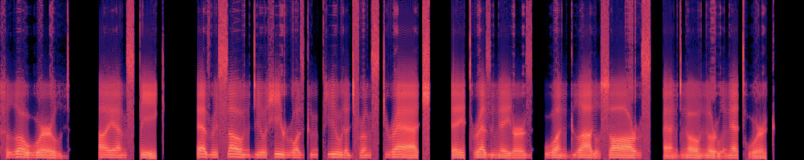](demo/hello.mp3)

> **Click any spectrogram to hear the clip.** GitHub does not play audio inline, so each image links to an MP3 in [`demo/`](demo/). There are also [waveform videos](#videos).

```sh
speak "Hello world."
speak -v klatt-drama "To deploy, or not to deploy?"
speak --sing=daisy
echo 'Dr. Smith paid $3.50 on 12/03/2024 at 5pm.' | speak -o receipt.wav
```

## Listen

### It talks

| | |
|---|---|
| **Hello** — the default voice introduces itself | [](demo/hello.mp3) |
| **The fox** — the classic pangram | [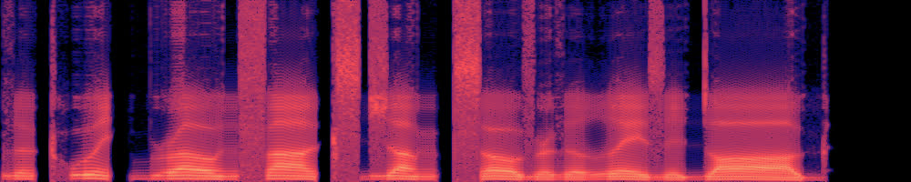](demo/fox.mp3) |
| **Numbers, dates, money, units, URLs** — `Dr. Smith paid $3.50 on 12/03/2024 at 5pm. The file is 2GB…` | [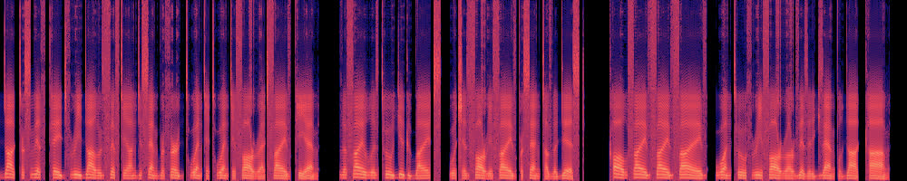](demo/normalizer.mp3) |
| **Questions rise, statements fall** | [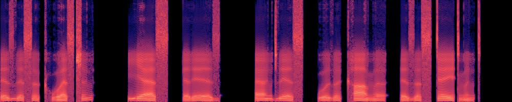](demo/question.mp3) |
| **320 words per minute** (`-r 320`) | [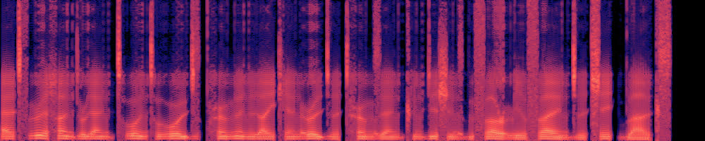](demo/fast.mp3) |
| **Straight from phonemes** (`--phonemes 'HH AX L OW1 …'`) | [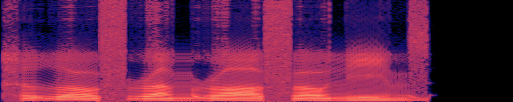](demo/phonemes.mp3) |

### It has personalities

A voice is a handful of numbers: pitch, vocal tract length, how the glottis opens and closes, how rough the source is, how wide the intonation swings, how long the pauses are.

| Voice | What it is | Listen |
|---|---|---|
| `klatt-male` | The default. 110 Hz, neutral. | [](demo/hello.mp3) |
| `klatt-female` | Higher pitch, shorter tract, some breath. | [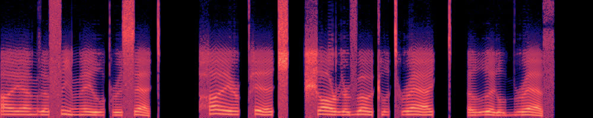](demo/voice-female.mp3) |
| `klatt-pip` | Bright and curious. Fast, wide pitch range. | [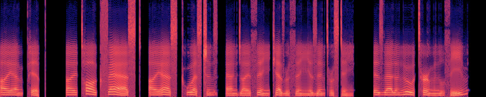](demo/voice-pip.mp3) |
| `klatt-calm` | Soft, slow, long pauses. Has read your stack trace. | [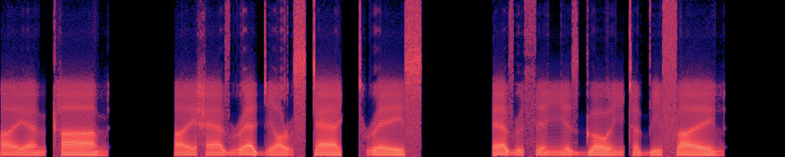](demo/voice-calm.mp3) |
| `klatt-gravel` | Low, rough source, creaks at the end of sentences. | [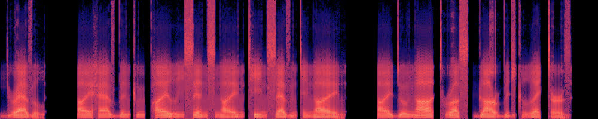](demo/voice-gravel.mp3) |
| `klatt-drama` | Theatrical. Very wide pitch range, deliberate pace. | [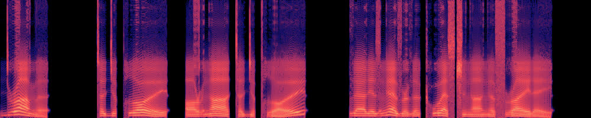](demo/voice-drama.mp3) |
| `klatt-robot` | Flat pitch, impulse source. The 1980 sound. | [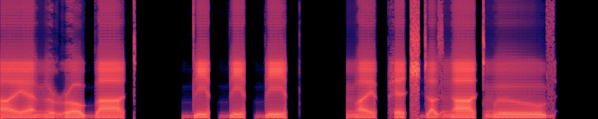](demo/voice-robot.mp3) |
| `klatt-whisper` | No voicing at all: noise through the same filters. | [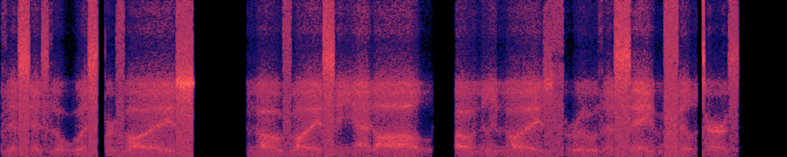](demo/voice-whisper.mp3) |

Also built in: `klatt-child`, `klatt-breathy`, `klatt-creaky`. Every parameter can be overridden: `speak -P oq=0.7 -P tl=14 -P jitter=2 -P range=1.6 "…"`.

### It has a second voice box

The formant synthesizer decides by rule where every resonance goes. The second backend does the opposite: it *measures* the filter from audio with linear prediction, stores it as 2,013 diphones (the transitions between every pair of sounds), and glues them back together. The first voice of this kind is bootstrapped from the formant synthesizer's own output, so it needs no recordings. Both backends take the same timed phonemes, so they can be compared on identical input.

| | |
|---|---|
| **Diphone LPC**, glottal excitation — `speak -b diphone "…"` | [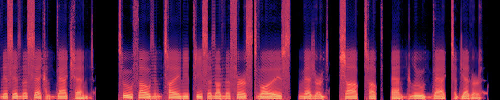](demo/diphone.mp3) |
| **Pulse excitation** — the Speak & Spell sound, `-P excitation=pulse` | [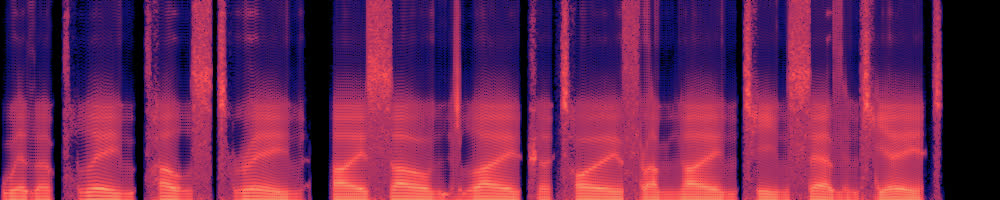](demo/diphone-pulse.mp3) |
| **It sings too** — pitch is free when the excitation is yours | [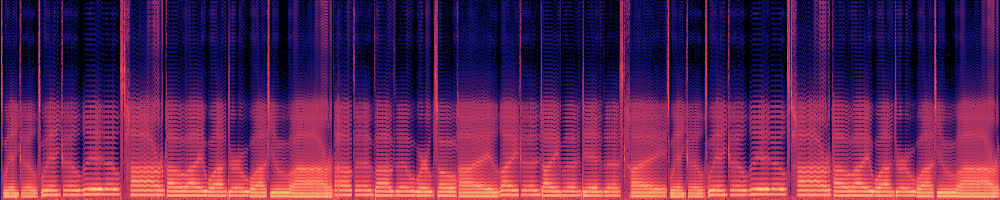](demo/diphone-sing.mp3) |

```sh
speak-lab diphones build --bootstrap      # 12 seconds, writes a 4.2 MB voice file
speak -b diphone "Hello from linear prediction."
```

### It can become you

The diphone backend does not care where its 2,013 diphones come from. `speak-lab` writes a prompt list (one nonsense word per diphone, most useful first), plays a guide for each, records you repeating it, and labels the recordings automatically by aligning them to the guide with dynamic time warping. No hand labelling.

```sh
speak-lab diphones prompts --out ~/speak-voice          # 2,013 prompts, about 100 minutes; a partial set works
speak-lab diphones record  --dir ~/speak-voice
speak-lab diphones build   --dir ~/speak-voice --name me
speak -v me "Hello. This is my own voice, more or less."
```

Tested without a microphone by a simulated speaker (a different voice, at a different speed, with random timing): the labeller places phone boundaries within 2.2 ms (median) of the truth.

### It is also a vocoder lab

`--resynth` takes any WAV file apart and puts it back together three different ways, with pitch and speed as free parameters.

```sh
speak --resynth voice.wav --vocoder lpc -P excitation=pulse     # linear prediction, robot excitation
speak --resynth voice.wav --vocoder psola --pitch +7st          # chipmunk, same speed
speak --resynth voice.wav --vocoder psola -r 120                # slower, same pitch
speak --resynth voice.wav --vocoder griffinlim                  # mel spectrogram and back, phases guessed
```

### It sings

In 1961 an IBM 704 sang *Daisy Bell*. `speak` does too. In sing mode each syllable takes one note, the vowel lands on the beat, pitch glides between notes, and held notes get a vibrato that fades in.

| | |
|---|---|
| **Daisy Bell** — `speak --sing=daisy` | [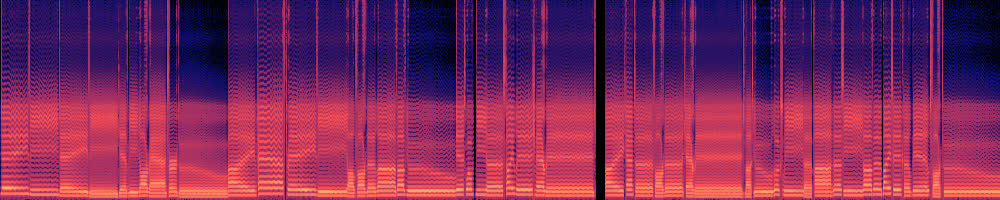](demo/sing-daisy.mp3) |
| **Twinkle, Twinkle** — `speak -v klatt-pip --sing=twinkle` | [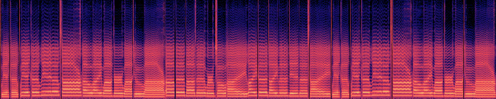](demo/sing-twinkle.mp3) |
| **Ode to Joy** — `speak -v klatt-calm --sing=ode` | [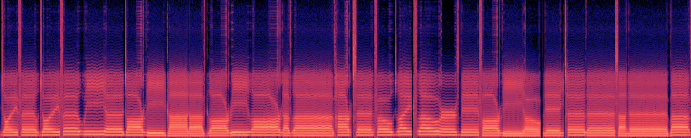](demo/sing-ode.mp3) |
| **Your own notes** — `speak --melody 'C4 E4 G4 C5:2 G4 E4 C4:2' --tempo 140 'la la la la, do re mi fa'` | [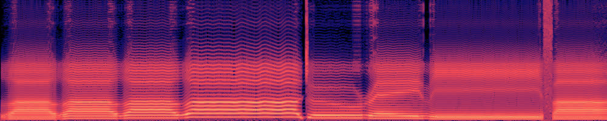](demo/sing-custom.mp3) |
| **"You're Absolutely Right!"** by [Lil' Backtick](https://backticks.no), verse 1 — melody transcribed from the recording, sung from a [notes file](tunes/youre-absolutely-right.melody) | [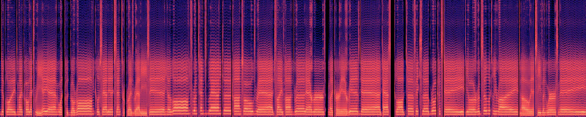](demo/sing-absolutely-right.mp3) |

Any text can be sung to any tune: `speak --sing=ode "I have no idea what I am doing but it compiles"`.

### Videos

Scrolling spectrogram and waveform, with sound: [hello](demo/hello.mp4) · [Daisy Bell](demo/sing-daisy.mp4) · [You're Absolutely Right](demo/sing-absolutely-right.mp4) · [klatt-drama](demo/voice-drama.mp4)

## Install

```sh
git clone https://github.com/HelgeSverre/speak && cd speak
cargo install --path .
```

Optional: a 126,000-word pronunciation lexicon (CMUdict, BSD-style licence). Without it `speak` pronounces every word by rule; with it, common words are looked up.

```sh
scripts/fetch-cmudict.sh                       # pinned revision, checksum verified
speak-lab lexicon build "$HOME/Library/Application Support/speak/lexicon/cmudict.dict"
```

Needs Rust 1.99. Works on macOS (Apple Silicon is the primary target). Linux needs ALSA headers (`libasound2-dev`) and is not yet verified.

## How it works

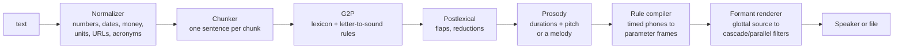

Every arrow is inspectable. `--dump` stops the pipeline at any stage and prints what it has:

```console
$ speak --dump text 'Dr. Smith paid $3.50 on 12/03/2024 at 5pm.'
doctor Smith paid three dollars fifty on december third twenty twenty four at five p m.

$ speak --dump phonemes 'Hello world.'
HH AX L OW1 / W ER1 L D .

$ speak --dump pho 'Hello.'
; chunk 0  "Hello."
HH   59
AX   33  0 119  100 116
L    74  0 116  100 120
OW1  268  0 120  30 125  100 78
_    350

$ speak --dump frames 'Hi.' | head -3      # tab-separated; columns aligned here
t_ms  f0     av   ah    af   oq    tl   f1   f2    f3    f4    b1   b2   b3   fnz …
0     126.1  0.0  55.0  0.0  0.50  6.0  660  1200  2550  3300  300  150  200  270 …
5     126.1  0.0  55.0  0.0  0.50  6.0  660  1200  2550  3300  300  150  200  270 …
```

**The synthesizer** is a Klatt cascade/parallel formant synthesizer, written from the 1980 and 1990 papers. A glottal source (KLGLOTT88 by default; Liljencrants-Fant and a 1980-style impulse source with `-P source=lf|impulse`, running at 4× the output rate so the pitch is never quantized to whole samples) feeds a nasal pole-zero pair and eight formant resonators in series. Fricatives and stop bursts go through a parallel bank with alternating signs. Parameters update every millisecond.

**The rules** turn a string of timed phones into those parameters. Each phone has formant targets; neighbours negotiate each boundary by rank (a stop dominates a vowel) and by locus (where the formant "points" at the moment of release). Short vowels undershoot their targets, as real ones do. Voiceless stops aspirate into the following vowel. Nasals pull the nasal zero. A /k/ before "oo" is a different sound from a /k/ before "ee", so stop bursts and loci depend on the vowel next to them.

**The frontend** is hand-written too: a normalizer that never drops a number, a 650-word exception lexicon, a letter-to-sound decision tree we train ourselves (with 570 hand-written rules in the 1976 NRL style as the comparison and fallback), Klatt's duration model, and a declination-plus-tune pitch model.

## The `say` you know

```
speak [-v voice] [-r rate] [-o outfile [--file-format=fmt] [--data-format=fmt]]
      [-a device] [-f file | string ...]
```

| | |
|---|---|
| `-v voice`, `-v '?'` | Pick or list voices |
| `-r 220` | Words per minute |
| `-o out.wav` / `out.aiff` / `out.raw` / `-` | Write a file or stdout; format from the extension, AIFF by default like `say` |
| `--data-format=LEF32@48000` | 16/24/32-bit integer or 32-bit float, either byte order, any sample rate |
| `-a device`, `-a '?'` | Pick or list output devices |
| `-f file`, stdin, interactive lines | All the ways `say` reads text |
| `[[slnc 500]]` `[[rate 300]]` `[[volm 0.5]]` `[[pbas 140]]` `[[inpt PHON]]` | Embedded commands |
| `--progress` | Progress on stderr |

Plus what `say` does not have:

| | |
|---|---|
| `--dump=text\|chunks\|phonemes\|pho\|frames` | See any intermediate stage |
| `--phonemes[=arpabet\|pho]` | Speak phonemes, or timed phonemes with pitch targets |
| `--pitch 140` / `--pitch +3st` | Base pitch or a shift |
| `-P key=value` | Any voice parameter |
| `--sing[=tune]`, `--melody`, `--tempo`, `--key` | Sing |
| `--timing[=json]`, `--bench` | Per-stage timing, time to first audio, real-time factor |
| `-b diphone`, `--resynth`, `--vocoder` | The second backend and the vocoder lab |
| `-i` | Highlight each word as it is spoken |
| `~/.config/speak/config.toml` | Defaults and named voice aliases |
| `~/.config/speak/lexicon.txt` | Your own pronunciations: `kubectl K Y UW1 B K AH2 T AX L` |

Ctrl-C stops the audio at once and still leaves a valid output file.

## Bonus: it has a mouth

If a [SidePulse](https://sidepulse.io/pro) LED strip is plugged in, `speak` drives it in sync with the audio: one pulse per syllable, wide and warm for open vowels like "father", narrow and cool for closed ones like "see", brighter on stressed syllables. The previous LED state is restored afterwards. `--no-lights` turns it off.

## Numbers

Measured on an Apple M2 Max.

| | |
|---|---|
| Real-time factor | formant 0.0015 · diphone 0.0003 (650× and 3,000× real time) |
| Time to first audio | 75–190 ms; nearly all of it is the OS opening the audio device |
| `hello world` to a file, wall time | `speak` 10 ms · macOS `say` 589 ms |
| 42 words to a file, wall time | formant 33 ms · diphone 18 ms · `say` 2,160 ms |
| Binary | 3.9 MB including the 1.5 MB letter-to-sound tree; no data files needed |
| Pretrained weights | 0 bytes |
| Intelligibility (word error rate, 20 sentences, transcribed by Whisper) | formant 18.0 % · diphone 27.3 % · diphone from simulated recordings 25.1 % · macOS `say` 3.3 % |
| Letter-to-sound phoneme error on a 588-word list | trained tree 2.0 % · hand rules 5.7 % |
| Letter-to-sound on 11,563 held-out CMUdict words | 52.1 % of words fully correct, stress included |
| Tests | 178 |

The intelligibility gap is real and expected: this is DECtalk-class speech, not neural speech. It started at 24 %; context-dependent consonant rules brought it to 18 %.

## Status

Everything in [`spec.md`](spec.md) up to milestone 10 of [`PLAN.md`](PLAN.md) is built: two synthesis backends, three glottal sources, three vocoders, two letter-to-sound methods, the full text frontend, `say` flag parity, voice building from recordings, analysis tools, benchmarks.

Not done:

- Linux is untested (the code is written for it; no container was available to verify).
- No human has recorded a voice with the recording tools yet; they are verified with a simulated speaker.
- A small neural acoustic model trained from scratch is a stretch goal and not started.

## Ground rules

1. **We write it ourselves.** Argument parsing, audio output, resampling and FFT come from crates. Synthesis, signal processing and text processing do not.
2. **No pretrained anything.** Not as a dependency, not as a download, not as a data file.
3. **Work from the papers.** Klatt 1980, Klatt & Klatt 1990, Klatt 1987, Elovitz et al. 1976. No GPL synthesizer code was read or ported.
4. **Measure.** macOS `say` and Whisper are used as test instruments, never as components.

## References

- D. H. Klatt, "Software for a cascade/parallel formant synthesizer", JASA 67, 1980
- D. H. Klatt and L. C. Klatt, "Analysis, synthesis, and perception of voice quality variations among female and male talkers", JASA 87, 1990
- D. H. Klatt, "Review of text-to-speech conversion for English", JASA 82, 1987
- H. S. Elovitz et al., "Automatic translation of English text to phonetics by means of letter-to-sound rules", NRL Report 7948, 1976
- The sing mode and the source perturbations borrow ideas (not code) from [CHIMERA](https://github.com/jamesondh/chimera-vocal-synth)

## Licence

MIT OR Apache-2.0, at your option ([LICENSE-MIT](LICENSE-MIT), [LICENSE-APACHE](LICENSE-APACHE)). The letter-to-sound tree in `data/` is derived from the CMU Pronouncing Dictionary; see [NOTICE](NOTICE).
